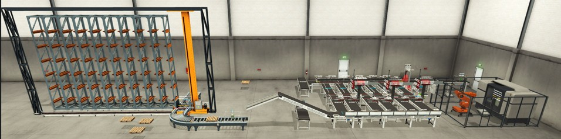
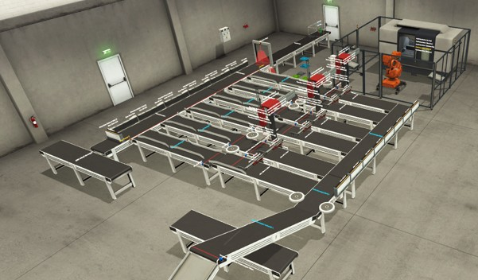

# Smart Factory Cell — Factory I/O scene + Siemens PLC program

A simulated production cell: parts are sorted by colour and type, assembled from a base and a lid,
stored in a matrix warehouse, and retrieved on request. A robotic CNC machining cell supplies
machined parts to the line.

The project ships as a Factory I/O scene plus the Siemens S7-1200 program that drives it. It is meant
to be opened, run and modified — the scene is a normal `My Scenes` file and the program is a normal
TIA Portal source, not a recording.

```
smart_factory.factoryio         Factory I/O scene (138 base objects + 3 cell objects)
plc/FB_MachiningCell.scl        machining cell block, importable into TIA Portal
plc/machining_center_tags.csv   tag table for that block
plc/LAD_networks.md             the same logic described for LAD entry
line-overview.jpg               production line, overview
sorter-field.jpg                sorter field and the machining cell
```

## Screenshots





## Process

```
raw parts -> sorter (6 lanes: 3 colours x base/lid) -> assembly x3 -> matrix warehouse (9x6)
                                    ^
                     machining cell: robot + CNC, lids 6 s / bases 3 s
```

| Stage | Equipment | Tags |
| --- | --- | --- |
| Infeed | emitter, entry conveyor, vision sensor | `Emitter 1 (Emit)`, `Entry Conveyor`, `Vision Sensor 1 (Value)` |
| Sorting | six pivot-arm sorters, one per colour/type | `Metal Base Arm`, `Metal Base Belt`, … |
| Assembly | three two-axis pick & place stations with clamps | `MB (Clamp)`, `Two-Axis Pick & Place 1 (Grab)`, … |
| Machining | one robot + one CNC (Factory I/O *Machining Center*) | `Machining Center 1 (Start)`, `(Is Busy)`, `(Progress)`, … |
| Storage | stacker crane and 9 x 6 rack | `Stacker Crane 1 Target Position`, `(Left)`, `(Right)`, `Lift` |
| Operator | emergency stop, start/stop buttons, status displays | `Emergency Stop 1`, `Start Button 1`, `Digital Display 1..3` |

## Requirements

- Factory I/O (2.4 or later) with the Siemens driver.
- TIA Portal V15.1 or later and an S7-1200 (PLCSIM or PLCSIM Advanced is enough).

## Running it

1. Copy `smart_factory.factoryio` to `Documents\Factory IO\My Scenes`.
2. Open it in Factory I/O and select *File → Drivers → Siemens S7-PLCSIM*.
3. In TIA Portal create an S7-1200 project, import `plc/machining_center_tags.csv` into the default
   tag table (*PLC tags → paste rows*).
4. Add `plc/FB_MachiningCell.scl` as an external source file and choose *Generate blocks*; call the
   block from OB1 (`plc/LAD_networks.md` has the call).
5. Export the Factory I/O tags to Siemens (*File → Export → Siemens*) and reconcile addresses with
   the tag table. Names are the contract — addresses only need to match your export.
6. Download, put the CPU in RUN, run the scene, press Start.

## Machining cell

The cell is Factory I/O's *Machining Center*: an articulated robot loads raw material into a CNC,
waits for the cycle, and places the finished lid or base on the exit bay. It is a **part production**
station, not a post-assembly machining step — colour comes from the raw material, the PLC only
chooses lid or base with `Machining Center 1 (Produce Lids)`.

`plc/FB_MachiningCell.scl` handles run/stop latching, fault latching from `(Has Error)`, reset,
part-type selection, a finished-part counter on the falling edge of `(Is Busy)`, a ready interlock,
and the infeed belt that only runs while the station is free. Ten networks, published in LAD form in
`plc/LAD_networks.md` and in SCL for direct import.

### Placement

The cell stands at the end of the installation line, clear of the sorter field so it reads as its own
station: cell `X 430, Z 172`, infeed belt `X 430, Z 202`, outfeed belt `X 430, Z 142`. The belts sit
30 units either side of the cell, which is the entry and exit bay spacing of Factory I/O's Machining
Center, so they line up with the bays without adjustment.

To move the station, drag the cell and the two belts together (select all three, then drag), or edit
the three `<Position>` values above the `<Drivers>` block in the scene file:

```xml
<Position X="430" Y="9" Z="172" />   <!-- MachiningCenter -->
<Position X="430" Y="3" Z="202" />   <!-- CNC Infeed Conveyor  -->
<Position X="430" Y="3" Z="142" />   <!-- CNC Outfeed Conveyor -->
```

Keep the 30-unit Z offset between cell and belts if you re-place it.

## Known limitations

- The cell is not conveyor-linked to the sorter lanes: both belts end about 20 units short of the
  nearest lane. Add one curved or 6 m conveyor if parts should travel between cell and line without
  manual handling.
- The addresses in `plc/machining_center_tags.csv` are the ones Factory I/O assigns by tag order in
  this scene. Re-check them after your own *File → Export → Siemens*, since the export renumbers
  whenever objects are added or removed. Tag names never change, so map addresses to names again.
- No HMI, alarms, trends or recipes. Sorting, assembly and storage logic from the base scene is
  unchanged.
- The scene contains 141 objects and 164 tags with no duplicate tag names; it is a plain Factory I/O
  scene file, nothing generated or patched at load time.


